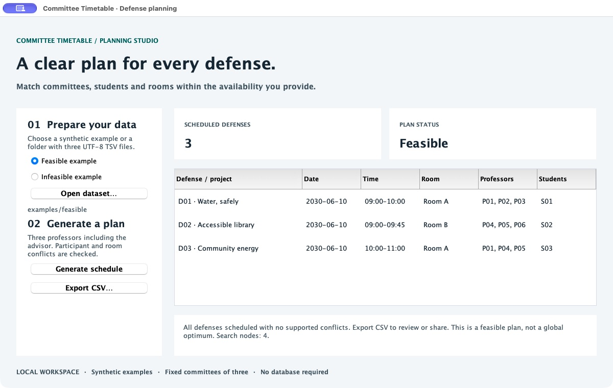

# Committee Timetable


[](https://github.com/kleberandrade/committee-timetable/actions/workflows/ci.yml)
[](LICENSE)

Plan final-project defense committees with a Java desktop application or a reproducible headless CLI. Supply fixed committees, participant availability and candidate room slots; the backtracking solver finds a feasible schedule or explicitly reports infeasibility/search exhaustion.

The original repository provided a JPA model, DAOs and Swing table models. Version 2 adds the actual scheduler, file boundary, desktop window, tests and a database baseline. It does **not** claim global optimality or automatically assign examiners.

## Requirements

- JDK **21** and Maven **3.9.11** (or use the included Maven Wrapper).
- A graphical desktop for Swing. CLI and unit tests work headlessly.
- Optional: Docker Compose for the isolated PostgreSQL **17.7** integration database. Scheduling itself needs no database.
- Internet access for the first Maven dependency download; subsequent offline builds need a populated local cache.

The dependency/plugin versions are pinned in `pom.xml`: Hibernate ORM 7.4.16.Final (Jakarta Persistence 3.2), PostgreSQL JDBC 42.7.14 and JUnit Jupiter 5.14.2. The [Hibernate compatibility matrix](https://hibernate.org/orm/releases/) documents Java 21 support.

## Build and run

```sh
./mvnw clean verify
java -jar target/CommitteeTimetable-2.0.0-app.jar --gui
```

Run from the repository root so the example paths resolve. In the desktop window select **Feasible example**, press **Generate schedule**, inspect the sortable timetable and **Export CSV…**. Select **Infeasible example** to see the diagnostic state. **Open dataset…** selects a directory containing your three TSV files. Files and search run in a background worker; empty, loading, invalid-input, infeasible and search-limit states have distinct text. Buttons have keyboard mnemonics, controls have accessible names, and errors remain visible without modal interruption.

```sh
java -Djava.awt.headless=true -jar target/CommitteeTimetable-2.0.0-app.jar \
  --input examples/feasible --output /tmp/committee-schedule.csv
java -Djava.awt.headless=true -jar target/CommitteeTimetable-2.0.0-app.jar \
  --input examples/infeasible
```

The first command schedules three synthetic defenses. CLI output refuses to overwrite an existing CSV. Exit codes: **0** feasible/help, **1** invalid input or I/O error, **2** proven infeasible for the supplied candidate set, **3** search limit. `--help` prints the command format. No real participant data is included.



## Dataset format

Copy `examples/feasible` and edit the UTF-8 files. Headers and column order are exact; values use tabs, with comma-separated participant IDs. No TSV quoting, blank lines or comments are supported. A file is limited to 1 MiB; an instance supports at most **200 defenses** and **5,000 candidate slots** to bound recursion and candidate storage.

- `defenses.tsv`: `id`, `title`, `minutes`, `advisor`, `professors`, `students`.
- `slots.tsv`: `date`, `start`, `end`, `room`.
- `availability.tsv`: `role`, `id`, `date`, `start`, `end`; role is `PROFESSOR` or `STUDENT`.

Use ISO dates (`2030-06-10`) and local times (`09:00`). Windows must end after they start on the same date. A defense has a positive duration, at least one student and **exactly three distinct professors including its advisor**. Every referenced participant requires explicit availability; unknown availability is never assumed free. Repeated rows in availability represent alternative windows; a defense must fit fully within one window per participant. IDs are trimmed and case-sensitive; professors and students have separate namespaces.

A slot is a **candidate start time and room reservation window**, not a range of arbitrary possible starts. For 09:00 and 09:15 alternatives, supply two rows. The defense starts at the candidate start and reserves only its duration. Adjacent defenses are allowed: intervals are `[start, end)`. Multiple slots may overlap; the solver still rejects overlapping reservations of the same room, professor or student. Different rooms can run in parallel when participants are disjoint.

## Articles, diagrams and solution guide

- [Architecture and class diagrams](docs/architecture.md): domain, use-case/adapters and preserved JPA class diagrams, with enforced dependency direction.
- [Clean Architecture in this project](docs/articles/clean-architecture.md): responsibilities, constructor injection, compatibility and extension paths.
- [Scheduling solution walkthrough](docs/articles/scheduling-solution.md): constraints, candidate filtering, backtracking trace, completeness, complexity and termination limits.
- [Articles and primary references](docs/articles/references.md): attributed reading from Robert C. Martin, Alistair Cockburn, Berkeley, ArchUnit and Hibernate.
- [Architecture decision record](docs/adr/001-clean-architecture.md): alternatives and trade-offs behind the implementation.

## Architecture and glossary

- `domain/Planning`: immutable, validated values. A **defense** is a project and its fixed committee/students; a **window** is local availability on one date; a **slot** pairs a window with a room; an **assignment** reserves a slot for a defense.
- `domain/Scheduler`: pure, deterministic backtracking over supplied candidates, ordered by fewest eligible slots. Each call owns its search state. Budget: **100,000 visited nodes** in CLI/GUI. `solve(request, limit)` lets embedding applications choose another positive limit.
- `application`: `GenerateSchedule` and `ExportSchedule` use cases with application-owned source/export ports. No filesystem, console, Swing or JPA dependencies.
- `adapters/in/cli`, `adapters/in/swing`: user interfaces injected with the same use cases.
- `adapters/out/file`: strict TSV parsing with file/line diagnostics and CSV output with explicit create-new/replace semantics.
- `bootstrap/CompositionRoot`: the single place that selects concrete source, solver, exporter and shipped search budget.
- `io/PlanFiles`: retained static compatibility facade for existing callers.
- `app`: stable executable/static compatibility entry methods. No network service or web conversion.
- `model`, `dao`, `tablemodel`: preserved JPA entities and legacy public CRUD/table APIs, upgraded to Jakarta. DAO calls own a transaction and return detached entities; failures propagate after rollback. Fetch lazy relationships inside an explicit persistence context when needed.
- `db/migrations`: versioned PostgreSQL baseline for **new** databases. `schema_version` records the applied baseline; Compose runs it only during initial database creation. There is no automatic migration runner.

The file scheduler deliberately does not write generated schedules into legacy tables. Legacy `Committee` has no room field, and its integer `day` has no documented calendar/date mapping. An implicit conversion would lose information. Keep the CSV as the reviewed schedule, or implement an explicit adapter/migration for your installation.

## PostgreSQL integration

```sh
docker compose up -d --wait
cp .env.example .env
set -a
. ./.env
set +a
./mvnw clean verify
```

This creates only the `committee-timetable` Compose project, database `committee_demo`, dedicated volume and loopback port **55439**. The committed credentials are public local-demo values. Use separate secrets for other environments. JPA reads `COMMITTEE_DB_URL`, `COMMITTEE_DB_USER`, `COMMITTEE_DB_PASSWORD`; it always **validates** schema instead of updating it. `COMMITTEE_DB_TEST=true` enables the real database tests; without it those two tests are explicitly skipped. Do not enable them against a live database: one test commits synthetic CRUD rows and removes them afterward; the relationship test rolls back.

```sh
docker compose stop
```

Stopping preserves the project volume. No reset or deletion of other databases is required.

## Migration from 1.x

Back up an existing database first and test migration on a private copy. Do **not** apply `V001__legacy_baseline.sql` to an existing schema. Compare the actual schema with the baseline and validate it with Hibernate; legacy source had broken provider/entity names and no checked-in DDL, so historical deployed schemas cannot be assumed identical.

Entity/property names and nullable legacy fields remain. `Professor`/`Degree` retain a shared `hibernate_sequence` with increment 1; identity IDs and join tables remain. The integer `day` values are not reinterpreted. No production data was inspected or converted. Jakarta imports replace `javax.persistence`, so callers must rebuild. The mis-typed `ProjectTypeDAO` now operates on `ProjectType`. DAO errors now throw instead of being printed and hidden. The old `com...utils.EntityManagerUtil` package remains available and its source directory now correctly matches `utils/`.

The earlier JPA 2.1, Hibernate 5.4 and JDBC 42.2.5 instructions are historical and have been replaced by the requirements above. The original modeling purpose and [entity-relationship diagram](figures/database.png) are preserved; that diagram describes the legacy model, not the new file scheduling value objects.

## Verification and limits

```sh
./mvnw clean verify
./mvnw spotless:apply  # apply the pinned Java formatting rules
# Optional locally installed analysis tools:
crapper --use-existing-coverage --threshold 10
dryer --threshold 0.8
mutator --use-existing-coverage --max-workers 2 \
  --test-command './mvnw -q -Dtest=SchedulerTest test' \
  src/main/java/com/kleberandrade/committeetimetable/domain
```

ArchUnit checks compiled dependencies between domain, application and adapters; Spotless checks Java formatting during `verify`. CI runs Java 21, a PostgreSQL service initialized with the same baseline, all behavior/integration tests, and packaged CLI smoke checks. JaCoCo HTML/XML is generated at `target/site/jacoco`; no unmeasured coverage badge is published. See [verification notes](docs/VERIFICATION.md) and the [action log](docs/WORK_LOG.md) for actual executed checks and limitations.

Supported constraints are fixed composition, duration, explicit professor/student availability and professor/student/room overlap. Expertise matching, examiner selection, workload fairness, travel/break times, existing calendar reservations, timezone conversion, recurring weeks and multi-day defenses are not implemented. Existing reservations must be represented by narrowing availability/removing slots. Infeasibility applies only to supplied candidates; a search limit leaves feasibility unknown. Search is exponential in the worst case; this is an educational planner for small instances.

## Contributing

See [CONTRIBUTING.md](CONTRIBUTING.md) for responsibility boundaries, behavior-first changes, formatting and documentation rules.

## Original project and license

Originally “Final Project Committee Timetabling Problem”, by **Kleber de Oliveira Andrade (2018)**: organizing final-project defenses within participant availability. The ER diagram and original entity model remain in the repository. No linked Medium article or shortened tutorial URL was found in the original README or sources; [review record](docs/medium-update.pt-BR.md).

Project source is [MIT](LICENSE). Dependencies retain their own licenses; see [third-party notices](docs/THIRD_PARTY.md). This modernization does not relicense dependencies or the original diagram.
