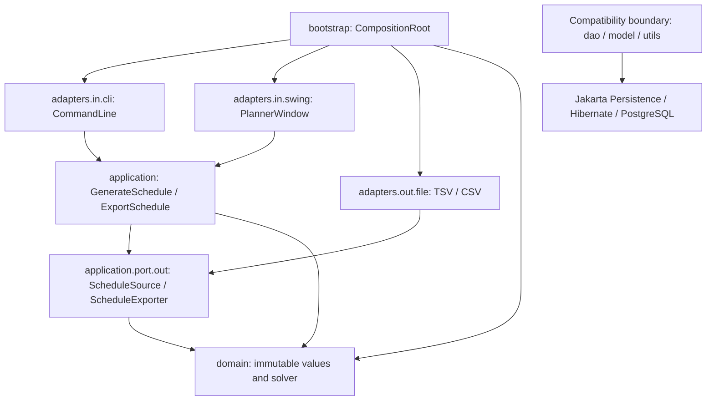
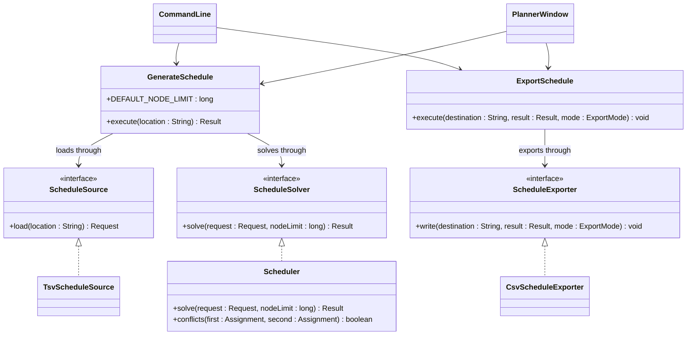
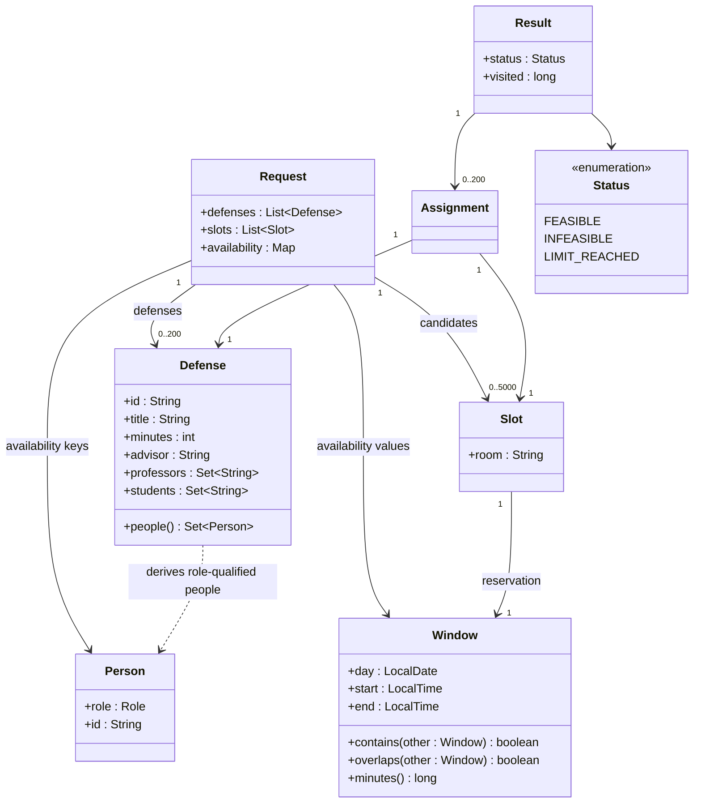
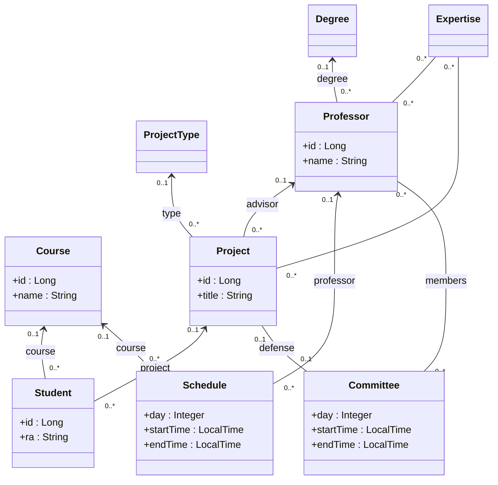

# Architecture and class diagrams

This is a single Java application with a framework-independent scheduling core. CLI and Swing share the same use cases. Filesystem adapters implement application-owned output ports. Dependency construction happens only in `bootstrap.CompositionRoot`.

The design follows the dependency rule described by [Robert C. Martin](https://blog.cleancoder.com/uncle-bob/2012/08/13/the-clean-architecture.html) and the replaceable boundary model described by [Alistair Cockburn](https://alistair.cockburn.us/hexagonal-architecture). The package and class descriptions below document this repository's implementation.

## Dependency direction

Arrows indicate **source dependencies**, not runtime call direction. Both file adapters depend on interfaces owned by the application; the application never imports the file implementations.

The historical JPA subsystem is a separate persistence boundary, **not** a dependency of scheduling use cases. There is no generated-schedule-to-JPA adapter: the legacy model lacks a room and a documented mapping from integer days to calendar dates. Drawing a persistence link into scheduling would misrepresent the implementation.

## Scheduling use-case class diagram

Methods below are public contracts; helper methods and presentation details are omitted.

`GenerateSchedule` validates and retains a positive search budget. `ExportSchedule` permits only `FEASIBLE` results. Neither knows `Path`, TSV, CSV, `JFrame`, `EntityManager`, a database password or console streams. The location/destination strings are opaque identifiers interpreted by the configured adapter. `PlanningException` carries boundary failures with their original cause.

`CompositionRoot` injects `TsvScheduleSource`, `Scheduler` and `CsvScheduleExporter`; tests can supply in-memory ports. `ScheduleTableModel` owns chronological, typed, read-only rows and reuses the existing generic column model; the window owns widget state and background-worker lifecycle. Changing the source technology therefore changes wiring and an adapter rather than either user interface or the solver. The use-case methods themselves are input boundaries; this small application does not need a separate interface for every concrete use case.

## Domain class diagram

`Request`, `Defense`, `Person`, `Slot`, `Window`, `Assignment` and `Result` are immutable nested records in `Planning`. `Role` and `Status` are nested enums. Names are shortened in the diagram for readability.

A `Person(PROFESSOR, "P01")` differs from `Person(STUDENT, "P01")`. A `Defense` stores participant IDs and derives qualified people when checking availability/conflicts. Availability maps each qualified person to alternative windows, and the entire defense must fit within one of those windows. Constructors copy lists, sets and map values so callers cannot mutate a running request.

## Preserved JPA class diagram

These are **persistence entities** in the historical `model` package, not the immutable scheduling records above. Associations show nullable legacy relationships; there is intentionally no three-professor database constraint on legacy `Committee.professors`.

`AbstractDAO<T>` implements the historical `IGenericDAO<T>` CRUD contract. Each operation owns its entity manager and transaction, commits on success, rolls back on a runtime persistence failure and propagates that failure. JPA validates the explicit PostgreSQL baseline. See [migration guidance](../README.md#migration-from-1x) before connecting an older schema.

## Enforced boundaries and compatibility

`DependencyRulesTest` uses ArchUnit on compiled production classes to enforce four rules in every build: domain depends only on domain/JDK classes; application depends only on application/domain and basic JDK types; input adapters cannot depend on output implementations/bootstrap/legacy persistence; output adapters cannot call user interfaces or bootstrap. These checks fail the build if a forbidden dependency is introduced.

The existing `app.Main`, `app.PlannerWindow.open`, `app.PlanPresentation` and `io.PlanFiles` entry methods remain as thin compatibility facades. Historical `dao`, `model` and `tablemodel` APIs keep their package names. `utils.EntityManagerUtil` now physically lives under `utils/`, matching its unchanged Java package. This is source-contract preservation, not a promise of binary compatibility for arbitrary reflective access to implementation internals.

Read the [architecture article](articles/clean-architecture.md), [solver walkthrough](articles/scheduling-solution.md), [reference library](articles/references.md) and [decision record](adr/001-clean-architecture.md) for implementation rationale, examples and limits.
